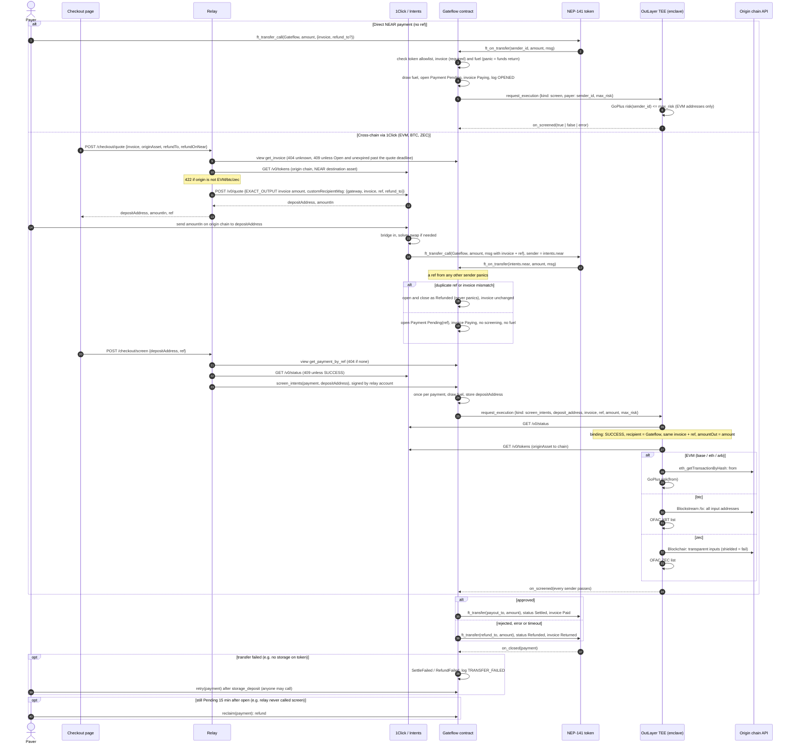

# Gateflow

Gateflow is a non-custodial compliance gateway for crypto checkouts on NEAR. A payment waits in the `Gateflow` contract while an OutLayer TEE screens the payer. After that, the contract can do only one of two things: settle the funds to the merchant or refund the payer.

A payer can pay from NEAR directly, or from an EVM chain (Base, Ethereum, Arbitrum), Bitcoin or Zcash through NEAR Intents 1Click. For cross-chain payments the enclave screens the real origin-chain senders, not the bridge account that delivers the tokens on NEAR. One gateway per merchant accepts every token on the operator's allowlist. The merchant issues on-chain invoices that fix the token, amount and expiry, and receives the payment's token on NEAR: USDC, nBTC (`nbtc.bridge.near`) or ZEC (`zec.omft.near`).

## Payment flow



- On the 1Click path the payer needs no NEAR: the relay signs `screen_intents` and pays its gas. The relay can only delay a payment, never approve one; the verdict comes from the enclave.
- The random `ref` binds the NEAR payment to its 1Click deposit. The enclave accepts a deposit address only if 1Click's stored quote carries the same invoice, `ref`, recipient and amount.
- Refunds go to `refund_to` on NEAR in the payment's token, not back to the origin chain.
- An invoice is Open, Paying, then Paid or Returned. Returned is final: the merchant issues a new invoice. Expiry is not a status; an Open invoice past `expires_at_sec` accepts no payment.
- Shielded Zcash senders cannot be screened, so they are always refunded.
- Every payment names an invoice, and only `intents.near` may deliver a `ref` payment, so contract storage grows only with merchant invoices and paid 1Click deliveries.
- The contract account holds no access keys and has no upgrade path. Tokens leave it only to the gateway's `payout_to` or the payment's `refund_to`.
- No KYC: there is no per-person limit; large payments are gated only by screening.

## Modules

| Module | Language | Role |
|---|---|---|
| `contract/` | Rust, near-sdk 5 | Token allowlist, gateways, invoices, risk policy, payments, paged views, `screen_intents`, settle / refund / retry |
| `enclave/` | Rust, `wasm32-wasip2`, OutLayer guest | `screen` (GoPlus), `screen_intents` (1Click binding, origin senders, GoPlus / OFAC) |
| `relay/` | TypeScript, Node built-ins only | The one backend: serves `web/`, merchant sessions and console API (SQLite), NEP-366 relayer with an allowlist, account provisioning, fuel top-ups, 1Click quotes and the screening watcher |
| `web/` | React, Vite, TypeScript | Merchant console (Home, Invoices, Screening, Settings, Search) and the public checkout at `/pay/<invoice>` |

## Build and test

```sh
cd contract && cargo test && cargo build --target wasm32-unknown-unknown --release
cd enclave && cargo test && cargo build --target wasm32-wasip2 --release
cd relay && node --test src/*.test.ts
cd web && npm ci && npx vitest run && npm run build
```

## Run the app

The relay serves the API and the built web app from one origin. Build `web/` first, then start the relay from `relay/`:

```sh
cd web && npm ci && npm run build
cd ../relay && GATEFLOW_CONTRACT=<contract> RELAY_ACCOUNT_ID=<operator> RELAY_PRIVATE_KEY=ed25519:… node src/main.ts
# open http://localhost:8787
```

`node --env-file=.env src/main.ts` reads the same variables from `relay/.env`. For UI work, run `npm run dev` in `web/` (port 5173); it proxies `/console` and `/checkout` to the relay on 8787.

| Variable | Default | Meaning |
|---|---|---|
| `GATEFLOW_CONTRACT` | (required) | Gateflow contract account |
| `RELAY_ACCOUNT_ID`, `RELAY_PRIVATE_KEY` | (required for writes) | Operator account: creates `<slug>.<operator>` merchant accounts, relays their signed delegate actions, pays gas, storage and fuel |
| `PUBLIC_URL` | `http://localhost:8787` | Public origin; `https:` turns on `Secure` session cookies |
| `DB_PATH` | `gateflow.db` | SQLite file with merchants, sessions and quotes; delete it to reset a demo |
| `WEB_DIST` | `../web/dist` | Built web app to serve |
| `FUEL_TARGET` | `100000000000000000000000` (0.1 NEAR) | Gateway fuel after a top-up; a top-up runs when fuel drops below two execution deposits |
| `EXECUTION_DEPOSIT` | `10000000000000000000000` (0.01 NEAR) | Must match the contract's `execution_deposit` |
| `MAX_MERCHANTS` | `100` | Onboarding cap; each merchant costs the operator about 0.02 NEAR |
| `NEAR_RPC_URL` | `https://rpc.testnet.fastnear.com` | NEAR RPC |
| `ONECLICK_URL`, `ONECLICK_API_KEY`, `EVM_CHAINS` | 1Click v0, none, `base,eth,arb` | NEAR Intents 1Click endpoint, optional key, and the EVM origins the enclave can screen |
| `VITE_NEAR_NETWORK` (web build) | `testnet` | Network for the checkout's NEAR wallets |
| `VITE_REOWN_PROJECT_ID` (web build) | none | Reserved for the Ethereum-wallet payer option, which is not wired yet (follow-up in `openspec/changes/archive/2026-11-01-web-console-checkout/tasks.md`) |

### The merchant's side

1. Sign in with an email. This is a demo sign-in: the email is not verified, and a session can only read.
2. Create a passkey. The browser derives the merchant's NEAR key from it (WebAuthn PRF); without PRF support it shows a recovery phrase instead. The key never leaves the browser.
3. Enter the business name. The operator creates `<slug>.<operator>` with the merchant's key as its only access key and registers it on every allowlisted token.
4. Confirm the gateway with the passkey. The merchant signs `create_gateway` as a NEP-366 delegate action, the backend relays it and funds the gateway's screening fuel.
5. Create invoices the same way (one passkey prompt each) and share `/pay/<id>`. The payer pays from a NEAR wallet or from another chain; the console shows the invoice as Paying, then Paid or Returned, and returned payments under Screening.

The backend only relays `create_gateway`, `create_invoice` and `set_policy` from the merchant's own account, with no deposit and at most 100 Tgas. It cannot sign for the merchant.

Running the relay, the enclave secrets and the deployment steps (testnet and mainnet) are in [GOAL.md → Engineering notes](GOAL.md#engineering-notes).

## Status

- Contract, enclave and relay for the cross-chain path are implemented and unit-tested. The relay's quotes and its NEAR signer have been run against live 1Click and testnet.
- The web console and checkout run end to end on testnet: onboarding, invoices, and a direct payment from a named account, which current screening returns.
- Not yet run on mainnet: deployment, enclave registration and live USDC / BTC / ZEC payments. Tracked in [`openspec/changes/mainnet-launch/tasks.md`](openspec/changes/mainnet-launch/tasks.md).
