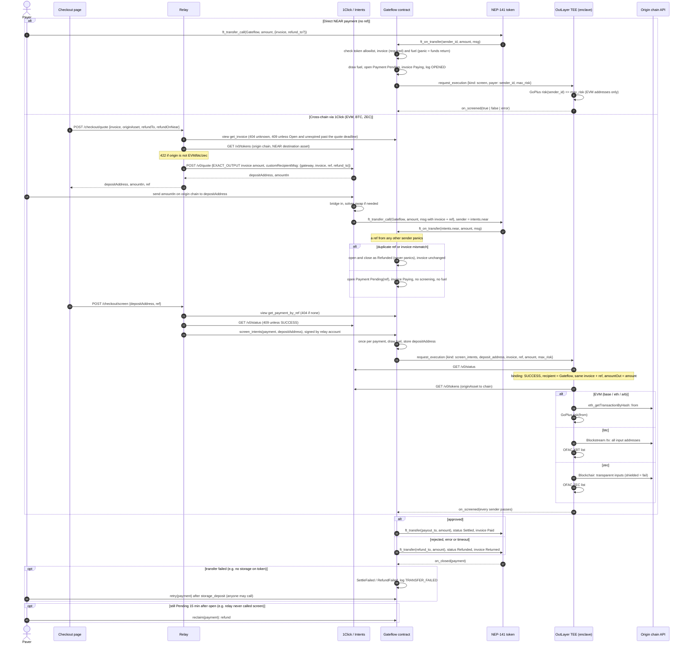

# Gateflow

Gateflow is a non-custodial compliance gateway for crypto checkouts on NEAR. A payment waits in the `Gateflow` contract while an OutLayer TEE screens the payer. After that, the contract can do only one of two things: settle the funds to the merchant or refund the payer.

A payer can pay from NEAR directly, or from an EVM chain (Base, Ethereum, Arbitrum), Bitcoin or Zcash through NEAR Intents 1Click. For cross-chain payments the enclave screens the real origin-chain senders, not the bridge account that delivers the tokens on NEAR. One gateway per merchant accepts every token on the operator's allowlist. The merchant issues on-chain invoices that fix the token, amount and expiry, and receives the payment's token on NEAR: USDC, nBTC (`nbtc.bridge.near`) or ZEC (`zec.omft.near`).

## Payment flow



- On the 1Click path the payer needs no NEAR: the relay signs `screen_intents` and pays its gas. The relay can only delay a payment, never approve one; the verdict comes from the enclave.
- The random `ref` binds the NEAR payment to its 1Click deposit. The enclave accepts a deposit address only if 1Click's stored quote carries the same invoice, `ref`, recipient and amount.
- Refunds go to `refund_to` on NEAR in the payment's token, not back to the origin chain.
- An invoice is Open, Paying, then Paid or Returned. Returned is final: the merchant issues a new invoice. Expiry is not a status; an Open invoice past `expires_at_sec` accepts no payment.
- Shielded Zcash senders cannot be screened, so they are always refunded.
- Every payment names an invoice, and only `intents.near` may deliver a `ref` payment, so contract storage grows only with merchant invoices and paid 1Click deliveries.
- The contract account holds no access keys and has no upgrade path. Tokens leave it only to the gateway's `payout_to` or the payment's `refund_to`.
- No KYC: there is no per-person limit; large payments are gated only by screening.

## Modules

| Module | Language | Role |
|---|---|---|
| `contract/` | Rust, near-sdk 5 | Token allowlist, gateways, invoices, risk policy, payments, paged views, `screen_intents`, settle / refund / retry |
| `enclave/` | Rust, `wasm32-wasip2`, OutLayer guest | `screen` (GoPlus), `screen_intents` (1Click binding, origin senders, GoPlus / OFAC) |
| `relay/` | TypeScript, Node built-ins only | The one backend: serves `web/`, merchant sessions and console API (SQLite), NEP-366 relayer with an allowlist, account provisioning, fuel top-ups, 1Click quotes and the screening watcher |
| `web/` | React, Vite, TypeScript | Merchant console (Home with the assistant, chat, Invoices, Screening, Settings, Search) and the public checkout at `/pay/<invoice>` |

## Build and test

```sh
cd contract && cargo test && cargo build --target wasm32-unknown-unknown --release
cd enclave && cargo test && GATEFLOW_CONTRACT=<contract> cargo build --target wasm32-wasip2 --release
cd relay && npm test
cd web && npm ci && npx vitest run && npm run build
```

## Run the app

The relay serves the API and the built web app from one origin. Build `web/` first, then start the relay from `relay/`:

```sh
cd web && npm ci && npm run build
cd ../relay && GATEFLOW_CONTRACT=<contract> RELAY_ACCOUNT_ID=<operator> RELAY_PRIVATE_KEY=ed25519:… node src/main.ts
# open http://localhost:8787
```

Mainnet runs on Fly.io at `https://gateflow.fly.dev`; see [Deploy (Fly.io)](relay/README.md#deploy-flyio). `node --env-file=.env src/main.ts` reads the same variables from `relay/.env`. For UI work, run `npm run dev` in `web/` (port 5173); it proxies `/console` and `/checkout` to the relay on 8787, except browser navigations to `/console/*`, which load the app.

| Variable | Default | Meaning |
|---|---|---|
| `GATEFLOW_CONTRACT` | (required) | Gateflow contract account |
| `RELAY_ACCOUNT_ID`, `RELAY_PRIVATE_KEY` | (required for writes) | Relay account: relays merchants' signed delegate actions, pays gas, storage and fuel |
| `MERCHANT_PARENT` | `RELAY_ACCOUNT_ID` | Account that creates merchant accounts `<label>.<MERCHANT_PARENT>` (8 random `a-z2-7` characters); the relay key must be a full-access key on it |
| `PUBLIC_URL` | `http://localhost:8787` | Public origin; `https:` turns on `Secure` session cookies |
| `DB_PATH` | `gateflow.db` | SQLite file with merchants, sessions, quotes and screening txs; delete it to reset a demo |
| `WEB_DIST` | `../web/dist` | Built web app to serve |
| `FUEL_TARGET` | `100000000000000000000000` (0.1 NEAR) | Gateway fuel after a top-up; a top-up runs when fuel drops below two execution deposits |
| `EXECUTION_DEPOSIT` | `10000000000000000000000` (0.01 NEAR) | Must match the contract's `execution_deposit` |
| `MAX_MERCHANTS` | `100` | Onboarding cap; each merchant costs the operator about 0.02 NEAR |
| `NEAR_RPC_URL` | `https://rpc.testnet.fastnear.com` | NEAR RPC |
| `ONECLICK_URL`, `ONECLICK_API_KEY`, `EVM_CHAINS` | 1Click v0, none, `base,eth,arb` | NEAR Intents 1Click endpoint, optional key, and the EVM origins the enclave can screen |
| `OUTLAYER_CONTRACT`, `OUTLAYER_PROJECT` | `outlayer.near`, `ops.gateflow.near/gateflow` | OutLayer contract and project whose active wasm hash the checkout shows; use `outlayer.testnet` and the testnet project on testnet |
| `OUTLAYER_API` | `https://api.outlayer.ai` | OutLayer coordinator API, used to find each screening's job for its attestation link; `https://testnet-api.outlayer.ai` on testnet |
| `LLM_BASE_URL` | `https://cloud-api.near.ai/v1` | OpenAI-compatible chat completions endpoint for the console assistant |
| `LLM_API_KEY` | none | Key for that endpoint. Without it, chat answers 503 and the composer shows "Assistant not configured" |
| `LLM_MODEL` | none | Model id with tool calling, from `GET <LLM_BASE_URL>/model/list`. Tested: `z-ai/glm-5.3-flash` (runs in a TEE, operated by NEAR AI) |
| `CHAT_DAILY_LIMIT` | `200` | Assistant messages per merchant per UTC day; beyond it chat answers 429 |
| `INVOICE_SIGNER_KEY` | none | `ed25519:` secret of the invoice signer key that merchants add with Enable API. Without it the merchant API is off |
| `VITE_NEAR_NETWORK` (web build) | `testnet` | Network for the checkout's NEAR wallets |
| `VITE_REOWN_PROJECT_ID` (web build) | none | Reserved for the Ethereum-wallet payer option, which is not wired yet (out of scope in `openspec/changes/web-from-scratch/proposal.md`) |

### The merchant's side

1. Sign in with an email. This is a demo sign-in: the email is not verified, and a session can only read.
2. Create a passkey. The browser derives the merchant's NEAR key from it (WebAuthn PRF); without PRF support it shows a recovery phrase instead. The key never leaves the browser.
3. Enter the business name. The backend creates `<label>.<MERCHANT_PARENT>`, where `<label>` is random and not the business name, with the merchant's key as its only access key and registers it on every allowlisted token.
4. Confirm the gateway with the passkey. The merchant signs `create_gateway` as a NEP-366 delegate action, the backend relays it and funds the gateway's screening fuel.
5. Create invoices the same way (one passkey prompt each) and share `/pay/<id>`. The payer pays from a NEAR wallet or from another chain; the console shows the invoice as Paying, then Paid or Returned, and returned payments under Screening.

The backend only relays `create_gateway` (paying out to the merchant's own account), `create_invoice` and `set_policy` from the merchant's own account, with no deposit and at most 100 Tgas. On the merchant's own account it relays only adding or deleting the invoice signer key (see [Accept payments on your site](#accept-payments-on-your-site)). It cannot sign for the merchant, except `create_invoice` once the merchant has enabled the API.

### The assistant

Home's composer, the hint chips, Search (Enter with no match) and the Invoices "Ask about invoices" input open a chat. The relay runs a tool-calling loop against `LLM_BASE_URL`: at most 6 tool rounds per message, the last 30 messages of the thread as context, and `CHAT_DAILY_LIMIT` messages per merchant per day.

- **Reads** (invoices, payments, settled totals, accepted tokens, gateway settings) run directly and only see the merchant's own gateway.
- **Writes only propose.** Creating an invoice, changing the risk tolerance or retrying a failed payment stores a pending action and shows a confirm card with the exact values. Nothing changes until the merchant presses Confirm: invoices and risk tolerance then take one passkey prompt, and the relay only submits a delegate whose call equals the stored action, once. Retries go through the operator.
- **Privacy:** NEAR AI Cloud serves models from TEEs, so payment data stays private in inference. Any other OpenAI-compatible endpoint works through `LLM_BASE_URL`, but then that privacy claim does not hold.

### Accept payments on your site

A shop creates one invoice per order from its server, opens the checkout on its own page, and fulfils the order when the webhook says it is paid. The shop needs no NEAR account, wallet or gas.

1. In **Settings > Developers**, press **Enable API** (one passkey prompt). Then create an API key, set a webhook URL and add your site to **Allowed origins**.
2. Create an invoice from your server:

   ```sh
   curl https://<gateflow>/api/v1/invoices \
     -H "Authorization: Bearer gf_live_..." \
     -H "content-type: application/json" \
     -d '{"amount":"10.00","currency":"USDC","order_id":"order_123"}'
   # 201 {"id":42,"url":"https://<gateflow>/pay/42","status":"open","amount":"10.00","currency":"USDC","order_id":"order_123","expires_at":"..."}
   ```

   `currency` is `USDC`, `BTC` or `ZEC`. `expires_in_sec` defaults to 1800. Posting the same `order_id` again while its invoice is open returns that invoice. `GET /api/v1/invoices/42` reads the live status: `open`, `paying`, `paid`, `returned` or `expired`. The limit is 60 new invoices per minute.
3. Open the checkout on your page:

   ```html
   <script src="https://<gateflow>/js/v1/gateflow.js"></script>
   <script>Gateflow.open(42, { onStatus: (e) => console.log(e.status) });</script>
   ```

   These events are for your UI only. Without the script, redirect to `url` with `?return_url=https://shop.example/done`, which must be on your allowed origins.
4. Fulfil on the webhook. Gateflow POSTs `{event, created_at, data}` for `invoice.paying`, `invoice.paid`, `invoice.returned` and `invoice.expired`, with the header `Gateflow-Signature: t=<unix s>,v1=<hex>`. `v1` is HMAC-SHA256 of `<t>.<raw body>` with your `whsec_` secret. A non-2xx answer is retried after 1 min, 5 min, 30 min, 2 h and 12 h.

[`examples/shop/`](examples/shop/) is a demo storefront that uses Node built-ins only. It has a cart, prices checkout on the server and creates one invoice per order. Its order page turns Paid only when the signed webhook arrives, and a strip at the bottom lists every webhook the server received. Items cost at most 0.01 USDC. Run `GATEFLOW_URL=https://<gateflow> GATEFLOW_KEY=gf_test_... GATEFLOW_WEBHOOK_SECRET=whsec_... node examples/shop/server.mjs`, expose port 8080 through an HTTPS tunnel, add the tunnel origin to Allowed origins and set the webhook URL to `<tunnel>/webhook`. The hosted demo runs at `https://gateflow-shop.fly.dev`; see [Demo shop](relay/README.md#demo-shop).

**Trust:** Enable API adds one key of the operator's to your account. That key can only call `create_invoice` on the Gateflow contract, and the relay refuses to add any wider key. An invoice always pays out to your gateway's payout account, so the key cannot move funds. If it leaked, it could only create invoices on your gateway, which uses up screening fuel at the rate limit. **Disable API** removes the key with one passkey prompt.

Relay modules, tests and the testnet dev deployment are in [`relay/README.md`](relay/README.md). Mainnet deployment steps are tracked in [`openspec/changes/mainnet-launch/tasks.md`](openspec/changes/mainnet-launch/tasks.md).

## Status

- The contract, the enclave and the relay are implemented and unit-tested.
- The enclave runs on OutLayer mainnet as project `ops.gateflow.near/gateflow`; its direct-call checks are in [`enclave/README.md`](enclave/README.md). It has not run on OutLayer testnet, because FastFS testnet was down.
- The relay runs against a testnet dev deployment (`gateflow-dev-v1.testnet`): merchant onboarding, sponsored `create_gateway` and `create_invoice`, fuel funding and the checkout views. A dry 1Click quote passes against the live API. See [`relay/README.md`](relay/README.md).
- `web/` (the console and the checkout page) is implemented and unit-tested. Every screen is translated from the `design/` exports. It has been checked against a local relay with in-memory contract and 1Click fakes, with virtual passkeys (with and without PRF); see [`web/README.md`](web/README.md). On mainnet it onboarded one merchant and took one cross-chain payment.
- The console assistant is implemented and tested against a stub model, and a passkey Confirm was checked in a local run with fakes. It has not yet run against NEAR AI Cloud or on testnet; the model is not chosen yet.
- Still open for the payer: the Ethereum-wallet option.
- `GOAL.md` is not yet in this repository.
- Mainnet: the contract is deployed at `gateflow.near` (operator `ops.gateflow.near`, relay `relay.gateflow.near`, merchant accounts under `merchant.gateflow.near`). One 0.01 USDC invoice paid through 1Click from an EVM chain is `Settled`. BTC and ZEC payments are not yet run. Tracked in [`openspec/changes/mainnet-launch/tasks.md`](openspec/changes/mainnet-launch/tasks.md).

## Roadmap

- **Bring your own screening keys (BYOK).** A merchant seals their own compliance provider key (first Chainalysis Sanctions) to the OutLayer enclave from the console, so Gateflow, the operator and the relay never see it. Screening then checks every address against that provider as well as the built-in GoPlus and OFAC checks, and a failed lookup fails closed. Deferred past the hackathon: it needs a per-gateway secrets profile on the contract, and `gateflow.near` has no access keys or upgrade path, so it means a new contract deployment and a move of merchants to it. Before shipping, the fuel credit on a failed OutLayer execution must change, or a merchant could drain the contract balance with a bogus profile.
