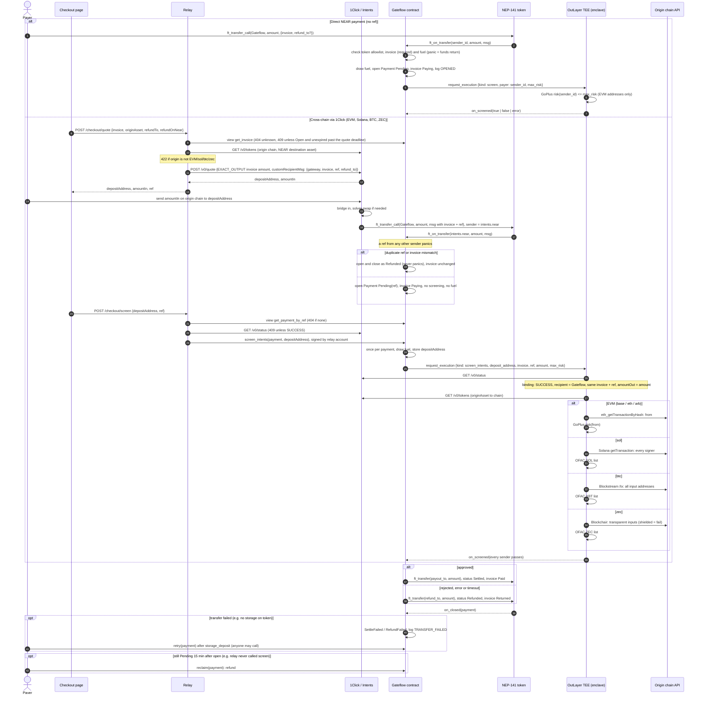

# Gateflow

Gateflow is a non-custodial compliance gateway for crypto checkouts.

## Overview

Taking crypto usually means running a crypto backend: blockchain nodes for every chain, hot wallets and keys, bridges, and a compliance vendor to screen who pays. Gateflow replaces that with a payment link or an API. A buyer pays from NEAR, an EVM chain, Solana, Bitcoin or Zcash. An OutLayer TEE screens the payer against sanctions and risk lists. The `Gateflow` contract on NEAR then does one of two things: it settles the funds to the merchant's own NEAR account, or it refunds the payer.

NEAR does the heavy lifting. NEAR Intents 1Click brings in deposits from other chains, NEP-366 meta transactions let merchants act without holding NEAR, and the contract enforces where funds may go. OutLayer runs the screening in a TEE and publishes an attestation for each verdict.

- **Live app (mainnet):** https://gateflow.fly.dev. The landing is at `/`, the merchant console at `/console`, and the checkout at `/pay/<invoice>`.
- **Demo shop:** https://gateflow-shop.fly.dev, a storefront that uses the merchant API, the checkout widget and signed webhooks.
- **Tracks:** Real-World Money (`realworld`), AI Security & Defense (`security`), Privacy & Private AI (`privacy`).

## Try it

The merchant side is free: the operator pays account creation, storage and gas. Paying an invoice costs 0.01 USDC from Arbitrum or Solana, plus the 1Click fee.

1. Open https://gateflow.fly.dev/console, sign in with any email, and create a passkey when asked. The email is not verified.
2. Enter a business name, then confirm the gateway with the passkey. You see Home, with today's settled totals and the assistant composer. Settings lists the payer networks.
3. Open Invoices and create a 0.01 USDC invoice (one passkey prompt). You see a `/pay/<id>` link, and the invoice is Open.
4. Open the link, pick Arbitrum or Solana, enter a refund address and a NEAR account you own, and send the amount shown to the deposit address. The page goes Paying, then Paid. The console shows the invoice as Paid and the payer as "`<address>` on `<chain>`".
5. On the paid checkout page, open the screening attestation. You see the OutLayer attestation for that verdict, with the enclave's wasm hash.

To test the shop flow, open https://gateflow-shop.fly.dev, buy an item, and pay in the checkout modal. The order turns Paid only when the signed `invoice.paid` webhook arrives, and the strip at the bottom lists every webhook the shop received.

## Verify on mainnet

These commands need only `curl` and `jq`. The outputs shown were taken on 2026-11-09.

The contract allowlists three tokens: USDC, nBTC and ZEC.

```sh
curl -s https://rpc.mainnet.near.org -H 'content-type: application/json' -d '{"jsonrpc":"2.0","id":1,"method":"query","params":{"request_type":"call_function","finality":"final","account_id":"gateflow.near","method_name":"get_tokens","args_base64":"e30="}}' \
  | jq -r '.result.result | implode'
# ["17208628f84f5d6ad33f0da3bbbeb27ffcb398eac501a31bd6ad2011e36133a1","nbtc.bridge.near","zec.omft.near"]
```

Payment 0 is the first mainnet payment. It was delivered by 1Click and settled.

```sh
curl -s https://rpc.mainnet.near.org -H 'content-type: application/json' -d '{"jsonrpc":"2.0","id":1,"method":"query","params":{"request_type":"call_function","finality":"final","account_id":"gateflow.near","method_name":"get_payment","args_base64":"eyJwYXltZW50IjowfQ=="}}' \
  | jq -r '.result.result | implode | fromjson | {invoice, payer, status, deposit_address}'
# {"invoice": 0, "payer": "intents.near", "status": "Settled", "deposit_address": "0x76fc1A1507d2D6a3f40E2983d3e3Af7238E201fc"}
```

1Click's record for that deposit shows it came from USDC on Arbitrum:

```sh
curl -s 'https://1click.chaindefuser.com/v0/status?depositAddress=0x76fc1A1507d2D6a3f40E2983d3e3Af7238E201fc' \
  | jq '{status, origin: .quoteResponse.quoteRequest.originAsset, tx: .swapDetails.originChainTxHashes[0].hash}'
# {"status": "SUCCESS", "origin": "nep141:arb-0xaf88d065e77c8cc2239327c5edb3a432268e5831.omft.near", "tx": "0x8d850d50359b240fdc95f476c6aea1bc0f2032c52e5b135e041a0780f34ee446"}
```

Payment 12 is a Solana USDC payment for invoice 46. The checkout's record shows the TEE verdict and the enclave build that gave it:

```sh
curl -s 'https://gateflow.fly.dev/checkout/invoice?id=46' \
  | jq '{status, payment, outcome: .screening.outcome, job: .screening.jobId, wasm: .screening.wasmHash}'
# {"status": "Paid", "payment": {"id": 12, "status": "Settled", "refundTo": "name.near"}, "outcome": "approved", "job": 1326858,
#  "wasm": "bceb9c0bc12a0a8e8c81b1e419c9b43ebe58511d4f2b8089b1195fa80a18e27a"}
```

The attestation is at https://app.outlayer.ai/attestation/1326858?network=mainnet. The Solana deposit tx is `2MGSRAMJmwZYsfpkLU84oro5ycUwK2MjRBAPFQTMY4f7g4ZHFThX2TuqHs46YYcdQCbsKgmjZHXFmJZJ63ZsXMiP`.

The contract account still has one full-access key, so its code can still be changed:

```sh
curl -s https://rpc.mainnet.near.org -H 'content-type: application/json' -d '{"jsonrpc":"2.0","id":1,"method":"query","params":{"request_type":"view_access_key_list","finality":"final","account_id":"gateflow.near"}}' \
  | jq '[.result.keys[] | .access_key.permission]'
# ["FullAccess"]
```

## How NEAR is used

- **NEAR Intents 1Click:** the relay quotes an exact-output swap into the invoice's token. 1Click then delivers it to the contract with `ft_transfer_call` from `intents.near`, carrying the invoice and a random `ref` in the message.
- **NEP-141 tokens:** USDC, nBTC (`nbtc.bridge.near`) and ZEC (`zec.omft.near`) are paid with `ft_transfer_call`, and payouts and refunds are `ft_transfer`.
- **NEP-366 meta transactions:** merchants sign `create_gateway`, `create_invoice` and `set_policy` as delegate actions with a passkey-derived key, and the relay pays the gas. Payers on the 1Click path need no NEAR either.
- **Function-call access key:** Enable API adds a key that can only call `create_invoice` on the contract, so a merchant's server can create invoices without a wallet.
- **Named accounts:** every merchant gets `<label>.merchant.gateflow.near`, created by the backend with the merchant's key as its only access key.
- **OutLayer (TEE on NEAR):** the contract calls `request_execution` on `outlayer.near`. The verdict comes back through `on_screened`, and each run has an attestation.
- **NEAR AI Cloud:** the console assistant's model runs in a TEE, so invoice and payment data stays private during inference.

## How it works



- On the 1Click path the payer needs no NEAR: the relay signs `screen_intents` and pays its gas. The relay can only delay a payment, never approve one; the verdict comes from the enclave.
- The random `ref` binds the NEAR payment to its 1Click deposit. The enclave accepts a deposit address only if 1Click's stored quote carries the same invoice, `ref`, recipient and amount.
- Refunds go to `refund_to` on NEAR in the payment's token, not back to the origin chain.
- An invoice is Open, Paying, then Paid or Returned. Returned is final: the merchant issues a new invoice. Expiry is not a status; an Open invoice past `expires_at_sec` accepts no payment.
- Shielded Zcash senders cannot be screened, so they are always refunded.
- Every payment names an invoice, and only `intents.near` may deliver a `ref` payment, so contract storage grows only with merchant invoices and paid 1Click deliveries.
- In the contract code, tokens leave only to the gateway's `payout_to` or the payment's `refund_to`. The operator still holds a full-access key on `gateflow.near`, so the deployed code can change until that key is deleted (see [Verify on mainnet](#verify-on-mainnet) and [Roadmap](#roadmap)).
- No KYC: there is no per-person limit; large payments are gated only by screening.

## Modules

| Module | Language | Role |
|---|---|---|
| `contract/` | Rust, near-sdk 5 | Token allowlist, gateways, invoices, risk policy, payments, paged views, `screen_intents`, settle / refund / retry |
| `enclave/` | Rust, `wasm32-wasip2`, OutLayer guest | `screen` (GoPlus), `screen_intents` (1Click binding, origin senders, GoPlus / OFAC) |
| `relay/` | TypeScript, Node built-ins only | The one backend: serves `web/`, merchant sessions and console API (SQLite), NEP-366 relayer with an allowlist, account provisioning, fuel top-ups, 1Click quotes and the screening watcher |
| `web/` | React, Vite, TypeScript | Merchant console (Home with the assistant, chat, Invoices, Screening, Settings, Search) and the public checkout at `/pay/<invoice>` |

## Build and test

Each command ends with the line shown in its comment. These were checked on 2026-11-09.

```sh
cd contract && cargo test                  # test result: ok. 80 passed; 0 failed
cd enclave && cargo test                   # test result: ok. 57 passed; 0 failed
cd relay && npm test                       # ℹ fail 0
cd web && npm ci && npx vitest run         # Test Files  9 passed (9)
node --test examples/shop/server.test.mjs  # ℹ fail 0
```

To build the deployable artifacts:

```sh
cd contract && cargo build --target wasm32-unknown-unknown --release
cd enclave && GATEFLOW_CONTRACT=<contract> cargo build --target wasm32-wasip2 --release
cd web && npm run build
```

## Run locally

The relay serves the API and the built web app from one origin. Build `web/` first, then start the relay:

```sh
cd web && npm ci && npm run build
cd ../relay && GATEFLOW_CONTRACT=<contract> RELAY_ACCOUNT_ID=<operator> RELAY_PRIVATE_KEY=ed25519:… node src/main.ts
# open http://localhost:8787
```

Every variable is listed in [`relay/README.md` § Configuration](relay/README.md#configuration). Mainnet runs on Fly.io; see [Deploy (Fly.io)](relay/README.md#deploy-flyio).

## The merchant's side

1. Sign in with an email. This is a demo sign-in: the email is not verified, and a session can only read.
2. Create a passkey. The browser derives the merchant's NEAR key from it (WebAuthn PRF); without PRF support it shows a recovery phrase instead. The key never leaves the browser.
3. Enter the business name. The backend creates `<label>.<MERCHANT_PARENT>`, where `<label>` is random and not the business name, with the merchant's key as its only access key and registers it on every allowlisted token.
4. Confirm the gateway with the passkey. The merchant signs `create_gateway` as a NEP-366 delegate action, the backend relays it and funds the gateway's screening fuel.
5. Create invoices the same way (one passkey prompt each) and share `/pay/<id>`. The payer pays from a NEAR wallet or from another chain; the console shows the invoice as Paying, then Paid or Returned, and returned payments under Screening.

The backend only relays `create_gateway` (paying out to the merchant's own account), `create_invoice` and `set_policy` from the merchant's own account, with no deposit and at most 100 Tgas. On the merchant's own account it relays only adding or deleting the invoice signer key (see [Accept payments on your site](#accept-payments-on-your-site)). It cannot sign for the merchant, except `create_invoice` once the merchant has enabled the API.

## The assistant

Home's composer, the hint chips, Search (Enter with no match) and the Invoices "Ask about invoices" input open a chat. The relay runs a tool-calling loop against `LLM_BASE_URL`: at most 6 tool rounds per message, the last 30 messages of the thread as context, and `CHAT_DAILY_LIMIT` messages per merchant per day.

- **Reads** (invoices, payments, settled totals, accepted tokens, gateway settings) run directly and only see the merchant's own gateway.
- **Writes only propose.** Creating an invoice, changing the risk tolerance or retrying a failed payment stores a pending action and shows a confirm card with the exact values. Nothing changes until the merchant presses Confirm: invoices and risk tolerance then take one passkey prompt, and the relay only submits a delegate whose call equals the stored action, once. Retries go through the operator.
- **Privacy:** NEAR AI Cloud serves models from TEEs, so payment data stays private in inference. Any other OpenAI-compatible endpoint works through `LLM_BASE_URL`, but then that privacy claim does not hold.

## Accept payments on your site

A shop creates one invoice per order from its server, opens the checkout on its own page, and fulfils the order when the webhook says it is paid. The shop needs no NEAR account, wallet or gas.

1. In **Settings > Developers**, press **Enable API** (one passkey prompt). Then create an API key, set a webhook URL and add your site to **Allowed origins**.
2. Create an invoice from your server:

   ```sh
   curl https://<gateflow>/api/v1/invoices \
     -H "Authorization: Bearer gf_live_..." \
     -H "content-type: application/json" \
     -d '{"amount":"10.00","currency":"USDC","order_id":"order_123"}'
   # 201 {"id":42,"url":"https://<gateflow>/pay/42","status":"open","amount":"10.00","currency":"USDC","order_id":"order_123","expires_at":"..."}
   ```

   `currency` is `USDC`, `BTC` or `ZEC`. `expires_in_sec` defaults to 1800. Posting the same `order_id` again while its invoice is open returns that invoice. `GET /api/v1/invoices/42` reads the live status: `open`, `paying`, `paid`, `returned` or `expired`. The limit is 60 new invoices per minute.
3. Open the checkout on your page:

   ```html
   <script src="https://<gateflow>/js/v1/gateflow.js"></script>
   <script>Gateflow.open(42, { onStatus: (e) => console.log(e.status) });</script>
   ```

   Or render the branded "Pay with crypto" button, which opens the invoice on click: `Gateflow.button("#pay", 42, { theme: "auto" })`. `theme` is `ink` (default), `white` for dark sites, or `auto`. Pass a function instead of the id to create the order on click; the button stays disabled until its promise settles.

   These events are for your UI only. Without the script, redirect to `url` with `?return_url=https://shop.example/done`, which must be on your allowed origins.
4. Fulfil on the webhook. Gateflow POSTs `{event, created_at, data}` for `invoice.paying`, `invoice.paid`, `invoice.returned` and `invoice.expired`, with the header `Gateflow-Signature: t=<unix s>,v1=<hex>`. `v1` is HMAC-SHA256 of `<t>.<raw body>` with your `whsec_` secret. A non-2xx answer is retried after 1 min, 5 min, 30 min, 2 h and 12 h.

[`examples/shop/`](examples/shop/) is a demo storefront that uses Node built-ins only. It has a cart, prices checkout on the server and creates one invoice per order. Its order page turns Paid only when the signed webhook arrives, and a strip at the bottom lists every webhook the server received. Items cost at most 0.01 USDC. Run `GATEFLOW_URL=https://<gateflow> GATEFLOW_KEY=gf_test_... GATEFLOW_WEBHOOK_SECRET=whsec_... node examples/shop/server.mjs`, expose port 8080 through an HTTPS tunnel, add the tunnel origin to Allowed origins and set the webhook URL to `<tunnel>/webhook`. The hosted demo runs at `https://gateflow-shop.fly.dev`; see [Demo shop](relay/README.md#demo-shop).

**Trust:** Enable API adds one key of the operator's to your account. That key can only call `create_invoice` on the Gateflow contract, and the relay refuses to add any wider key. An invoice always pays out to your gateway's payout account, so the key cannot move funds. If it leaked, it could only create invoices on your gateway, which uses up screening fuel at the rate limit. **Disable API** removes the key with one passkey prompt.

## Status

Checked on 2026-11-09 against mainnet `gateflow.near` (operator `ops.gateflow.near`, relay `relay.gateflow.near`, merchants under `merchant.gateflow.near`, enclave `ops.gateflow.near/gateflow` version `bceb9c0b…`).

| Payer origin | Supported | On mainnet | Evidence |
|---|---|---|---|
| Arbitrum USDC (1Click) | yes | settled | payments 0–11. Payment 0 is invoice 0, origin tx `0x8d85…e446` |
| Solana USDC (1Click) | yes | settled | payment 12, invoice 46, Solana tx `2MGSRAMJ…XMiP`, OutLayer job `1326858` |
| Base, Ethereum USDC (1Click) | yes | not yet run | unit tests (`enclave`, `relay`) |
| Bitcoin to nBTC (1Click) | yes | settled | payment 13, invoice 49, Bitcoin tx `cdd65880…7c2c`, OutLayer job `1327511` |
| Zcash to ZEC (1Click) | yes | not yet run | unit tests. Shielded Zcash is always refunded |
| NEAR direct (`ft_transfer_call`) | yes | not yet run | unit tests (`contract`) |
| Refund after a flagged or unbound payment | yes | not yet run | unit tests (`contract`, `enclave`) |

- **Console and checkout:** live on mainnet. Merchants onboard with a passkey, and the checkout shows each screening's verdict, wasm hash and attestation link.
- **Merchant API, widget and webhooks:** live on mainnet and used by the demo shop.
- **Assistant:** configured on the mainnet relay with `z-ai/glm-5.3-flash` on NEAR AI Cloud. Unit tests cover the confirm-before-write flow against a stub model.
- **Not built:** paying with an Ethereum wallet from the checkout. EVM payers send to the 1Click deposit address instead.
- **Contract key:** `gateflow.near` still has a full-access key (see above). Deleting it is on the roadmap.

Relay modules, tests and deployments are in [`relay/README.md`](relay/README.md). The enclave build, deploy and versions are in [`enclave/README.md`](enclave/README.md). Mainnet launch tasks are in [`openspec/changes/archive/2026-11-10-mainnet-launch/tasks.md`](openspec/changes/archive/2026-11-10-mainnet-launch/tasks.md).

## Disclosures

- **Built at NEAR HACKATHON.** The first commit is 2026-11-01, so there is no code from before the hackathon.
- **Other chains:** Gateflow is not a port. There is no existing Gateflow product on another chain.
- **Other projects:** this team submits no other project.
- **AI tools:** the code, tests and docs were written with Claude Code, driven by OpenSpec. Every change's proposal, design and task list is kept in [`openspec/changes/archive/`](openspec/changes/archive/), and current behavior is specified in [`openspec/specs/`](openspec/specs/).
- **Libraries:**
  - contract: `near-sdk` 5
  - enclave: `serde` and `serde_json`
  - relay and `examples/shop`: Node built-ins only
  - web: React, NEAR Wallet Selector (`@near-wallet-selector/*`), `lucide`, `qrcode`, Vite and Vitest
- **External services:** NEAR Intents 1Click, OutLayer, GoPlus, the OFAC lists from [0xB10C/ofac-sanctioned-digital-currency-addresses](https://github.com/0xB10C/ofac-sanctioned-digital-currency-addresses), Blockstream, Blockchair, publicnode RPCs, and NEAR AI Cloud.
- **License:** MIT ([`LICENSE`](LICENSE)).

## Roadmap

- **Delete the contract's full-access key.** This makes `gateflow.near` immutable, so funds can only ever go to `payout_to` or `refund_to`.
- **Run the remaining origins on mainnet:** Base, Ethereum, Zcash, NEAR direct, and one refund.
- **Bring your own screening keys (BYOK).** A merchant seals their own compliance provider key (Chainalysis Sanctions first) to the OutLayer enclave from the console, so Gateflow, the operator and the relay never see it. Screening then checks every address against that provider as well as the built-in GoPlus and OFAC checks, and a failed lookup fails closed. This needs a per-gateway secrets profile in the contract: either an upgrade while the full-access key exists, or a new deployment once it is deleted. Before it ships, the fuel credit on a failed OutLayer execution must change, or a merchant could drain the contract balance with a bogus profile.
- **GoPlus for Solana.** Solana payers are screened against the OFAC list only. GoPlus's address API answered `{"code":5000}` for Solana on 2026-11-09.
- **Pay with an Ethereum wallet from the checkout.**
